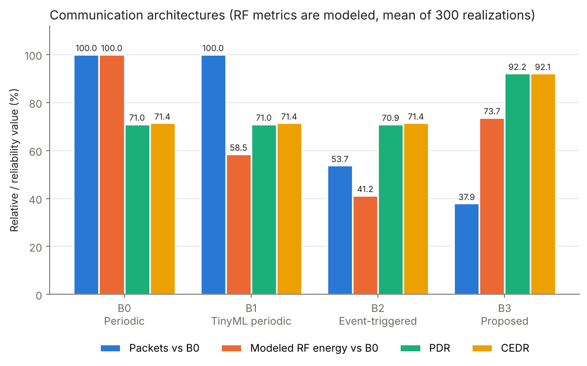

# Value-Aware RF-Enabled TinyML for Environmental Monitoring

[](https://doi.org/10.5281/zenodo.23478036)

Reference implementation of the Phase-1 computational experiment in:

> Nnaji, K. T., Isogun, O., Wanisi, C. M.-B., & Dominic, E. C. (2026). Value-aware RF-enabled TinyML embedded architecture for intelligent environmental monitoring in resource-constrained environments: A computational experimental evaluation. *ISA Journal of Engineering and Technology (ISAJET)*, 3(5), 50–68. https://doi.org/10.5281/zenodo.23337367

The architecture lets an on-device classifier decide not only *what* the environment is doing, but *whether* that information is worth sending and *how much radio reliability* to spend on it. An Environmental Value-of-Information (VoI) score combines predicted severity, prediction uncertainty, temporal novelty and information age; a cross-layer controller turns that score and the link state into a transmit/suppress decision, a payload size, a LoRa spreading factor and a transmit power.

## Key results

On the weekly Mauna Loa CO₂ record (2,231 sequences, chronological 70/15/15 split):

- **Prediction.** The selected Random Forest reaches 89.85% test accuracy and 87.6% macro-F1 on a three-class future-state task. A 3.9 KB tiny 1-D CNN comes within 0.3 points of its accuracy.
- **Communication.** Against periodic fixed-RF telemetry (B0), the value-aware controller (B3) sends 62% fewer packets and 68% fewer bytes, and uses 26% less modeled RF energy.
- **Reliability.** Mean packet-delivery ratio rises from 71% to 92%, and critical-event delivery from 71% to 92%, across 300 modeled link realizations.
- **Trade-off.** Event-triggered telemetry (B2) uses the least energy but delivers only about 71% of packets, so minimizing energy alone does not give the most useful system.
- **Ablation.** Removing RF-link adaptation causes the largest drop in delivery reliability.



> **Note.** Values the paper states are reproduced exactly where possible. Where the paper does not specify a detail, this code makes an explicit, configurable choice, and some results differ from the published ones as a result (for example the link model, the calibrated thresholds and the CNN). Every such difference is listed under [Assumptions](#assumptions-and-differences-from-the-paper). All RF results are simulation/model-based, not radio measurements.

## Quick start

Requires Python 3.10 or later (developed and tested with 3.13).

```bash
git clone https://github.com/TosinISOGUN/VoI-TinyML-RF.git
cd VoI-TinyML-RF
python -m venv .venv && source .venv/bin/activate   # Windows: .venv\Scripts\activate
pip install -r requirements.txt

python scripts/run_all.py            # full run, 300 Monte Carlo realizations (~2 min on a laptop CPU)
python scripts/run_all.py --realizations 50   # quicker run
python -m pytest tests               # checks pinned to values stated in the paper (~10 s)
```

No download is needed: the weekly Mauna Loa CO₂ record (1958–2001, 2,284 weeks) ships with `statsmodels`.

Outputs land in `results/`:

| File | Paper equivalent |
|---|---|
| `tables/table2_models.csv` | Table 2, model comparison with bootstrap CIs |
| `tables/table3_selected_model_per_class.csv` | Table 3 |
| `tables/table4_5_communication_montecarlo.csv` | Tables 4–5, with 2.5/97.5 percentiles |
| `tables/table6_ablation_seed202.csv` | Table 6 |
| `tables/voi_threshold_grid_validation.csv` | Sec. 4.8 grid search |
| `tables/montecarlo_realizations.csv` | Per-realization RF metrics |
| `figures/fig3_*.png` … `fig6_*.png` | Figures 3–6 |
| `results.json` | Everything above, plus McNemar p-values and the paper's published values |

## Repository layout

```
src/voi_tinyml/
  config.py        every constant, with paper section references; assumptions marked
  data.py          dataset, 51 temporal features, future-state labels, chronological split
  models.py        Decision Tree, Random Forest, MLP, Tiny 1-D CNN (PyTorch)
  evaluation.py    metrics, bootstrap CIs, exact McNemar tests
  voi.py           severity, entropy, novelty, information age, VoI policy
  lora.py          LoRa time-on-air, transmit energy, link model, adaptive (SF, P_TX) selection
  telemetry.py     communication systems B0–B3 and RF metrics (PDR, CEDR)
  experiments.py   end-to-end workflow (Fig. 2)
  plots.py         Figures 3–6
scripts/run_all.py
tests/test_pipeline.py
```

## Method summary

| Stage | Implementation |
|---|---|
| Data | Weekly Mauna Loa CO₂, linear interpolation of missing weeks |
| Features | W = 24: 24 values, 24 first differences, current standardized anomaly, sin/cos week-of-year (51 features) |
| Labels | z₍t+1₎ = (x₍t+1₎ − μ_t)/σ_t over a rolling 52-week baseline; classes at training quantiles 0.50 / 0.80 |
| Split | Chronological 70/15/15 (1,561 / 335 / 335) |
| Models | DT (depth 10, leaf 6), RF (32 trees, depth 9, leaf 4), MLP (24-12, α = 3×10⁻⁴), Tiny CNN (2 ch, 2×8 filters, k = 3) |
| VoI | V = 0.40 S + 0.20 U + 0.20 D + 0.20 A |
| Controller | Transmit if V ≥ T1; 32 B if V ≥ T2, predicted class 2 or U ≥ 0.72, else 12 B; delivery target 0.94 / 0.82 |
| Radio | SF 7–12, 14/17/20/22 dBm, 125 kHz, CR 4/5, 8-symbol preamble, CRC, explicit header, LDRO at SF11–12 |
| Link | Logistic success model, slope 0.72, on SNR − SNR_req(SF) + 0.11 (P_TX − 14) |
| Evaluation | 300 link realizations; ablation on link seed 202; ML seed 42 |

## Reproduced results

**Exact matches:** 2,231 sequences; 1,561/335/335 split; thresholds q₀.₅₀ = 0.3716 and q₀.₈₀ = 1.3221; test classes 164/103/68; τ_D = 0.90; Random Forest accuracy 89.85%; B0 and B1 energies (15,823.54 mJ and 9,257.76 mJ, confirming the LoRa time-on-air model at SF9/17 dBm).

### Classification (test set)

| Model | Accuracy | Macro-F1 | Size (KB) | Paper accuracy / macro-F1 / size |
|---|---|---|---|---|
| Decision Tree | 85.07 | 82.40 | 11.52 | 84.48 / 81.97 / 11.36 |
| **Random Forest** | **89.85** | **87.63** | 414.98 | 89.85 / 88.08 / 421.27 |
| MLP | 82.69 | 76.90 | 47.20 | 83.58 / 78.68 / 27.29 |
| Tiny 1-D CNN | 89.55 | 87.50 | 3.90 | 82.69 / 78.59 / 4.03 |

The Random Forest is selected (best validation macro-F1), as in the paper. Its accuracy 95% CI is 86.57–92.84% (paper: 86.57–93.13%), its macro-F1 CI is 83.53–91.29% (paper: 84.20–91.72%) and class-2 recall is 89.71% (paper: 91.18%). The selection margin is narrow: validation macro-F1 is 84.65% for the RF against 83.40% for the CNN.

Exact McNemar tests, RF against each other model:

| Comparison | p (this code) | p (paper) |
|---|---|---|
| RF vs Decision Tree | 0.0052 | 0.0039 |
| RF vs MLP | 0.0015 | 0.0038 |
| RF vs Tiny CNN | 1.00 | 0.0027 |

The CNN here is stronger than the published one, so the RF-vs-CNN difference is not significant here.

<details>
<summary>Note on model sizes</summary>

Sizes are pickled (scikit-learn) or `torch.save` (CNN) artifacts and vary slightly by library version and platform (about ±0.05 KB between Windows and Linux). The MLP is larger than the paper's because the pickled scikit-learn object carries training state: its weights are 12.7 KB, but the Adam optimizer moments (25.5 KB), an early-stopping copy of the best weights (12.8 KB), the loss history and the scaler are pickled with it.

</details>

### Communication (300 modeled link realizations)

| System | Packets | Bytes | RF energy (mJ) | PDR (%) | CEDR (%) |
|---|---|---|---|---|---|
| B0 Periodic fixed RF | 335 | 10,720 | 15,823.54 | 70.98 | 71.43 |
| B1 TinyML periodic | 335 | 4,020 | 9,257.76 | 70.98 | 71.43 |
| B2 Event TinyML fixed RF | 180 | 3,740 | 6,522.67 | 70.90 | 71.43 |
| B3 VoI + adaptive RF | 127 | 3,444 | 11,658.03 | 92.17 | 92.13 |
| *Paper B3* | *92* | *2,764* | *10,738.93* | *94.44* | *87.04* |

Relative to B0, B3 reduces transmissions by 62.1% (paper 72.5%), bytes by 67.9% (74.2%) and modeled energy by 26.3% (32.1%), while raising PDR by 21.2 points (23.7) and CEDR by 20.7 points (10.6). The paper's central finding holds: B2 uses the least energy but B3 delivers far more reliably.

<details>
<summary>Spread across realizations (2.5–97.5 percentiles) compared with the paper</summary>

| Range | This code | Paper |
|---|---|---|
| B0 PDR (%) | 63.6–77.9 | 66.57–74.33 |
| B3 PDR (%) | 87.0–96.1 | 90.22–97.83 |
| B3 energy (mJ) | 8,933–15,187 | 8,775.85–12,916.25 |

The ranges here are wider than the paper's. The paper's B0 range is narrower than independent per-packet draws alone would give (about ±4.9 points at PDR ≈ 0.71 over 335 packets), so its link-trace model must differ from the one assumed here (see Assumption 1). The time-correlated AR(1) shadowing used here makes whole realizations better or worse than average, which widens the ranges.

</details>

### Ablation (link seed 202)

Removing RF-link adaptation causes the largest PDR drop (93.7% → 73.2%), as in the paper. Unlike the paper, removing severity sharply reduces critical-event delivery here (92.6% → 22.1%), because without it the calibrated thresholds suppress most class-2 observations. Removing uncertainty also lowers CEDR (to 83.8%), whereas the paper found little effect.

## Assumptions and differences from the paper

The paper does not specify the following; each choice is set in `config.py` and can be changed:

1. **Link-trace model.** SNR follows AR(1) shadowing (σ = 2.5 dB, φ = 0.7) around a mean of −10.95 dB, calibrated so fixed-RF PDR ≈ 70.8%. The controller sees the SNR with 1 dB Gaussian estimation error. Reception uses one uniform draw per slot shared by all systems. The paper reports CEDR above PDR for B0 (76.41% vs 70.78%), which implies time-correlated link quality aligned with critical events; this generic model gives CEDR ≈ PDR instead.
2. **Threshold calibration.** T1 and T2 come from a validation grid (0.300–0.900, step 0.025) over 50 link realizations. This yields T1 = 0.450, T2 = 0.650 (paper: 0.575, 0.675), and so more B3 transmissions (127 vs 92). Applying the paper's thresholds directly to this VoI score transmits too few critical events, so the published thresholds are not hard-coded.
3. **B2 trigger.** Transmit when the predicted state is elevated (class ≥ 1) or has changed; 32 B for predicted class 2, else 12 B. With the paper's confusion matrix this gives 78 large packets, consistent with its 3,684 bytes.
4. **Novelty lag.** r = 1 (one-week change), which reproduces τ_D = 0.90 exactly.
5. **Information age.** The stream starts as if an update was sent just before the first test week.
6. **Ablations.** A removed VoI component's weight is redistributed so the weights still sum to one; the no-uncertainty variant also drops the U ≥ 0.72 payload rule.
7. **Tiny CNN.** Channels are the mean-centred CO₂ window and its first differences, standardized with training statistics; same padding; class-weighted cross-entropy; batch 64; early-stopping patience 10.
8. **First usable week.** Index 52, which reproduces the paper's 2,231 sequences.

Small model differences (for example the RF confusion matrix) are expected across library versions. Results here were produced with Python 3.13, scikit-learn 1.9.1, PyTorch 2.14.1, statsmodels 0.15.0, NumPy 2.5.3 and pandas 3.0.5.

## Limitations

As in the paper, this is a computational study. Model file sizes are not embedded Flash/SRAM figures, and RF energy, PDR and CEDR come from models, not radio hardware. Next steps are multivariate validation on the Beijing Multi-Site Air Quality dataset and measurements on a physical MCU and LoRa platform.

## Maintainer

Oluwatomisin Isogun ([ORCID 0009-0009-1419-7928](https://orcid.org/0009-0009-1419-7928), [@TosinISOGUN](https://github.com/TosinISOGUN)). Questions and issues are welcome on the [issue tracker](https://github.com/TosinISOGUN/VoI-TinyML-RF/issues).

## Citation

If you use this code, please cite the paper and the archived software release (DOI [10.5281/zenodo.23478036](https://doi.org/10.5281/zenodo.23478036)); see `CITATION.cff`.

## License

Code: MIT (see `LICENSE`). The paper itself is published under CC BY-NC 4.0.
